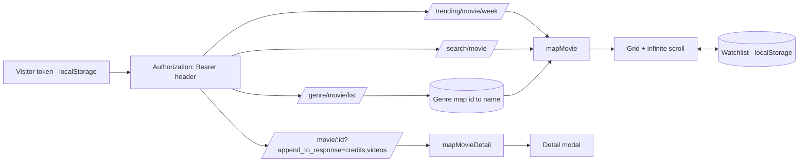

# Architecture — CineLog

**Shape:** three static files — `index.html`, `styles.css`, `app.js`. No build, no framework. Two top-level states: **setup** (no valid token) and **app**.

**Data flow:**

**Layers inside app.js:**
1. **API layer** — `tmdb()`: builds the Bearer header from localStorage at call time (changing the token needs no reload), maps 401/429/other to typed errors, accepts an AbortSignal for list loads.
2. **Mapper layer** — `mapMovie()` (poster URL construction, genre-id join, year/rating normalisation) and `mapMovieDetail()` (top-5 cast, first YouTube Trailer selection, runtime).
3. **State** — mode (trending/search), query, page/totalPages for infinite scroll, genre filter, view (all/watchlist), loaded movies, per-flow AbortController.
4. **Render** — card grid with append-only page rendering, watchlist view re-render, detail modal.

**Pagination:** an IntersectionObserver sentinel with 400px rootMargin triggers the next page; loading guard prevents overlap; termination at `min(total_pages, 500)`.

**Watchlist storage:** array of mapped movie objects in localStorage (id-keyed). Storing the mapped shape — not raw payloads — keeps the watchlist view renderable offline.
